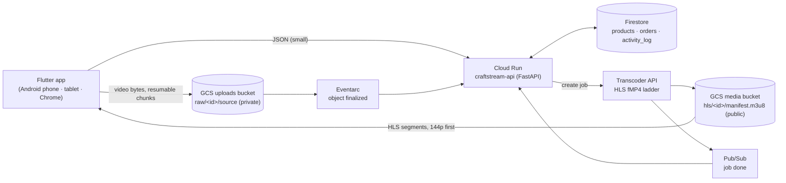

# CraftStream

A marketplace where artisans sell handmade goods by showing **how** they are made. An artisan uploads a process video
(up to 15 minutes, any file size) with a title, description and price. A buyer searches by keyword or tag, watches the
video **smoothly on a connection under 50 kbps**, and places an order. One Flutter codebase runs on Android phones,
Android tablets and Chrome; the backend runs entirely on Google Cloud. Built for the DevDolphins technical assignment
(`docs/Technical_Assignment.pdf`; requirements in [docs/INTENT.md](docs/INTENT.md)).

| | |
|---|---|
| **Web app** | https://craftstream-qi0tvg.web.app |
| **API** | https://craftstream-api-424435123536.asia-south1.run.app (liveness: [`/health`](https://craftstream-api-424435123536.asia-south1.run.app/health)) |
| **GCP project** | `craftstream-qi0tvg`, everything in `asia-south1` |
| **Android** | `make apk ENV=prod` builds a release APK against the same backend |

Home has two doors that stand in for login: **Sell** is the artisan (upload), **Buy** is the buyer (search, watch,
order). **Activity log** (next to Your orders) shows every step of every upload, video and order, newest first.

## Architecture



- **Video bytes never pass through the API.** The app uploads straight to Cloud Storage with a resumable session
  (any size; after a drop it asks GCS how much arrived and resumes). Eventarc, not the app, starts transcoding, and
  Pub/Sub reports the result, so closing the app after the upload is fine.
- **The player starts on the lowest rung.** The ladder has a 256×144 rung of about 40 kbps that is listed first, and the
  player is configured to start there instead of guessing a high bandwidth.
- **One architecture rule.** Anything that might change (limits, bitrates, breakpoints, text, colours) lives in a YAML
  rule file, and every rule file has exactly one schema, one loader and one engine named after it:
  `config/<domain>/<xyz>.yml` → `schemas/<domain>/<xyz>_schema` → `domain/<domain>/<xyz>_loader` →
  `domain/<domain>/<xyz>_engine`. Schemas reject unknown keys, so a typo fails at startup; engines are pure, so they
  are trivial to test; a convention test fails if any piece is missing. The same pattern is used in Python and in Dart.
- **Everything that describes behaviour or appearance is YAML (V2).** Screens, their building blocks ("bricks"),
  routes, navigation, design tokens, icons, strings and status labels in the app; limits, the video life cycle,
  storage paths, error codes, the activity log's events and the GCP resources on the backend. Dart and Python are
  only the engines that read them. See [How to read the YAML](#how-to-read-the-yaml).
- **Activity log.** The API records each step it sees (listing created, video landed, transcoding, ready, order
  placed, refused calls, unexpected errors) and the app reports the ones only it sees (upload started, connection
  dropped, resumed, finished). Entries live in Firestore for 14 days (TTL). Events, levels, groups and messages are
  declared in `backend/config/platform/activity_log.yml`; entries never hold a buyer's name, an upload URL or a token.
- **One contract for both sides.** `models/*.yml` and `models/endpoints.yml` are the only definition of the data and
  routes; `make gen` writes the Pydantic models, the Dart models and the Dart API client. A test fails if the FastAPI
  routes differ from `endpoints.yml` or if generated code is stale.

The full picture, request flows, ladder and key decisions: [docs/ARCHITECTURE.md](docs/ARCHITECTURE.md).

## How to read the YAML

A screen is a list of bricks bound to data. `frontend/assets/config/ui/screens/logs.yml`, shortened:

```yaml
data: logs                       # the source in lib/shared/screens/sources.dart that feeds `logs.*`
width: wide
top:
  - brick: top_bar               # Home / Activity log / <listing>: every crumb but the last is a link
    crumbs:
      - { brick: crumb, text: common.home, action: { go: / } }
      - { brick: crumb, text: logs.title }
body:
  - brick: chip_row              # Uploads · Videos · Orders · System
    bind: logs.groups
    all: logs.all_groups
    all_selected: logs.all_groups
    action: { call: set_group, with: item.value }
  - brick: list
    bind: logs.items
    item: { brick: log_row, listing: logs.listing, order: logs.order }
```

| To change… | Edit | Checked by |
|---|---|---|
| a screen's content or order | `frontend/assets/config/ui/screens/<name>.yml` | startup check + render test (every screen, 4 sizes, light and dark) |
| a brick's look | `frontend/assets/config/ui/bricks.yml` (style, in theme tokens) | the brick catalogue test |
| colours, type, spacing | `frontend/assets/config/ui/theme.yml` | contrast test (WCAG pairs, both modes) |
| any text | `frontend/assets/config/ui/strings.yml` | strings test (no missing or unused keys) |
| routes | `frontend/assets/config/app/routes.yml` | every `go:` must match a route |
| limits, ladder, life cycle, log events | `backend/config/<domain>/*.yml` | schema (unknown keys fail), engine tests |
| GCP resources | `infra/gcp/resources.yml` (`make infra-print` shows the commands) | infra test |

Every rule file has one schema (unknown keys fail at startup), one loader and one engine named after it, plus an
engine test; a convention test fails if any piece is missing, and a literal lint keeps colours, sizes, paths and
status strings out of code.

## Requirements and how they are met

| # | Requirement | How, and what was measured |
|---|---|---|
| R1 | Upload a ≤ 15-min video of any size | Resumable upload straight to GCS in 8 MiB chunks (chunk size from `upload_policy.yml`, served to the app by `/upload-policy`). A **43.8 MB, 900 s** clip went through the deployed pipeline end to end. Resume after a dropped connection verified in Chrome with a real connection reset mid-chunk: the app asked GCS for the received offset and continued. The app checks duration on the device before uploading; the server measures the upload with `ffprobe` and caps longer videos at 15:00 in the Transcoder job. |
| R2 | Title, description, price | Stored in Firestore with the product and shown on the product screen. |
| R3 | Search by keyword and tag | `GET /products?q=&tag=` returns only `ready` products; keyword rules (stopwords, prefix index) live in `catalog/search.yml`. Tag chips and a debounced search box in the app. |
| R4 | Watch the process video | HLS (fMP4) from the public media bucket; hls.js on Chrome, ExoPlayer on Android. |
| R5 | Smooth playback under 50 kbps | **Lowest rung: 43.5 kbps on the wire**, averaged over the real 15:00 upload transcoded on GCP (worst 6 s segment 45.8 kbps): 256×144 H.264 at 12 fps plus 12 kbps mono HE-AAC, 6 s fMP4 segments. Chrome against the live backend at a **45 kbps / 300 ms** throttle: starts on 144p, **0 mid-playback stalls over 2 minutes**, 13.6 s from tap to first frame, buffer grows ahead of playback. `make test` re-checks the budget on every run. Android emulator through a **45 kbps** capped proxy (`tools/throttle_proxy.py`) against the live backend: starts on 144p, plays in real time (58 s of video in 59 s), no stalls over 6 minutes. |
| R6 | Place an order | `POST /orders` validates, computes the total server-side (`order_rules.yml`, Decimal rounding) and stores `status=placed`. The flow ends at "Order placed". |
| R7 | Android phone, tablet, Chrome | One Flutter codebase; layouts come from `layout.yml` size classes (phone / tablet / wide), tested at 390, 820 and 1280 px in light and dark. Android emulator through a **45 kbps** capped proxy (`tools/throttle_proxy.py`) against the live backend: starts on 144p, plays in real time (58 s of video in 59 s), no stalls over 6 minutes. |
| R8 | Backend fully on GCP | Cloud Run, Cloud Storage, Transcoder API, Firestore, Eventarc and Pub/Sub, all in the dedicated project `craftstream-qi0tvg`. Idempotent setup scripts in `infra/gcp/`. |

## Repo map

```
models/          shared data models + endpoints (YAML) → `make gen` → code for both sides
backend/         FastAPI service on Cloud Run       (rules in config/, layers in app/, tests/)
frontend/        Flutter app                         (rules in assets/config/, layers in lib/, test/)
infra/gcp/       idempotent gcloud scripts: project, buckets, Firestore, IAM, deploy, Eventarc/Pub/Sub
tools/           codegen.py, local_hls.py (FFmpeg ladder for local testing), smoke_test.py; defaults in tools.yml
docs/            INTENT, ARCHITECTURE, PLAN, BACKEND_PLAN, FRONTEND_PLAN, EVIDENCE
```

Backend layers (`backend/CLAUDE.md`): routers → services → engines; services also use repositories (Protocol +
in-memory + Firestore) and `infra/gcp` (or `infra/local` fakes). Frontend layers (`frontend/CLAUDE.md`):
screen → controller → engine (rules) or repository (data); `lib/data/providers.dart` is the only place that chooses
between mock data and the generated API client.

## Running it locally

```bash
make setup                 # backend/.venv + dependencies (Python 3.12)
make api                   # API on :8000 in local mode: in-memory data, a fake GCS resumable target, no GCP needed
make web                   # Flutter web app on :8080 with in-app mock data
make web MOCK=false        # the same app against `make api` (real upload with resume, real orders)
make hls SRC=video.mp4     # build the HLS ladder locally with FFmpeg and report the bitrate per rung
```

`CRAFTSTREAM_MODE=local` runs the whole flow with no GCP account: the local upload target speaks the same
resumable protocol as GCS, and the local transcoder finishes instantly with a public sample stream.

**Tests.** Run them in batches rather than all at once (the full Flutter suite is heavy on small machines):

```bash
cd backend && .venv/bin/python -m pytest -q tests/unit/media     # one folder at a time: unit/*, api, config_validation, integration
cd frontend && ~/development/flutter/bin/flutter test --concurrency=1 test/core   # then test/domain, test/data, test/features/…
```

- Backend: **265 tests**, including the convention test (every YAML has its schema, loader and engine), the
  routes-match-`endpoints.yml` test, the architecture test (import rules), and the bitrate-budget test that encodes a
  grainy clip and asserts the lowest rung stays ≤ 50 kbps.
- Frontend: **239 tests**, including every screen at four sizes in light and dark, Home fitting one screen from
  360×640 to 1920×880, the buyer flow (search → product → checkout → order placed), the upload flow with a simulated
  drop and resume (and its steps in the activity log), orders surviving a restart, and a check that every string in
  the screens exists in `strings.yml` and vice versa.

## Deploying

```bash
cp infra/gcp/config.env.example infra/gcp/config.env   # project id, region, web origins
bash infra/gcp/setup.sh        # 01 APIs → 02 buckets → 03 Firestore → 04 IAM → 05 Cloud Run → 06 Eventarc + Pub/Sub
backend/.venv/bin/python tools/smoke_test.py https://<cloud-run-url>   # upload → ready → search → order against the deployment
make web-build ENV=prod && (cd frontend && firebase deploy --only hosting)   # web app → Firebase Hosting
```

Every script is idempotent. `/internal/*` accepts only Google-signed OIDC tokens from the project's events service
account. No secrets are in the repo: `.env`, `config.env` and `.mcp.json` values come from the environment.

## Hard rules and non-goals

- Video bytes never pass through the API; HLS is served from the media bucket, not the API.
- The player starts on the lowest rung, and the lowest rung stays ≤ 50 kbps on the wire (test-enforced).
- Local mode must keep working with no GCP.
- No secrets in the repo; env files that ship in the app hold public settings only (test-enforced).
- **Out of scope:** login/accounts, payments, shipping, reviews. The flow ends at "Order placed".

## Known limits

- The artisan's "my products" list is kept in memory, so it is lost on reload against the real backend: there is no
  login and no "list my products" endpoint.
- On Android the file picker copies the chosen video into the app cache before uploading (fine for demo sizes;
  reading through content URIs would avoid the copy).
- On Android the starting bitrate cannot be forced from Dart (`video_player` has no track-selection API). Playback
  starts low because the lowest rung is listed first in the master playlist, which was confirmed on the real GCP output.
- The hosted web app's first load is about 2.5 MB compressed (Flutter's CanvasKit renderer). For a throttled demo,
  load the app first, then switch the throttle on. Repeat visits are about 6 KB: the app and its rules have
  content-hashed names and are cached (`tools/web_bundle.py`), because Firebase Hosting never answers 304.
- Like the rest of the app (no login, by design), the activity log is open: anyone with the URL can read it and post
  the app's upload events (the server refuses its own events from the app). Entries hold ids, sizes and reasons
  only, and expire after 14 days.
- Upload progress moves per 8 MiB chunk, not per byte.
